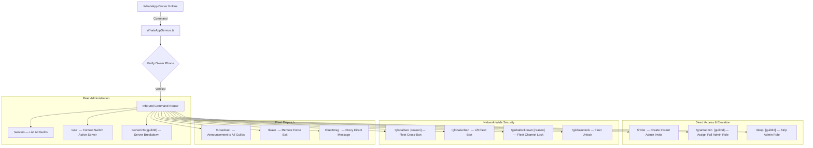

# Global Multi-Server Admin & Fleet Management Plan
**Rage Optimiser Enterprise — WhatsApp Remote Control System**

---

## 1. Executive Summary
This document outlines the architecture, command specifications, and implementation roadmap for providing **Global "God Mode" Administrator Access** across all Discord servers in which the Rage Optimiser bot is present. 

All controls are securely mediated through the **Rage WhatsApp Hotline**, strictly authenticated against the verified owner phone number (`process.env.WHATSAPP_OWNER_NUMBER`).

---

## 2. Command Architecture & Technical Specifications



---

## 3. Detailed Command Specifications

### Suite A: Fleet Discovery & Context Switching
* **`!servers` / `!guilds`**
  * **Function:** Queries `client.guilds.cache` across the Discord gateway.
  * **Output:** Clean WhatsApp blockquote list containing:
    * Server Name
    * Server ID (monospace)
    * Total Member Count
    * Bot Permissions Status (`[ADMINISTRATOR]`, `[RESTRICTED]`)
    * Indicator showing which server is currently the active context.
* **`!use <guildId | serverName>`**
  * **Function:** Sets `WhatsAppService.activeTargetGuildId` in memory.
  * **Behavior:** Subsequent single-target commands (`!ban`, `!kick`, `!lockdown`, `!say`, `!whois`, `!ticketinfo`, etc.) immediately route to this server.
* **`!serverinfo [guildId]`**
  * **Function:** Inspects the target guild (or active guild if omitted).
  * **Output:** Owner Discord Tag, Server Creation Date, Verification Level, Nitro Boost Tier, Channel Count, and Role Hierarchy.

---

### Suite B: Instant Admin Access & Elevation ("Keys to the Server")
* **`!invite <guildId>`**
  * **Function:** Finds the highest-permission text channel in the specified guild and creates an instant, non-expiring invite link (`maxAge: 0, maxUses: 0`).
  * **Output:** Sends the clickable invite URL directly to WhatsApp for 1-tap entry.
* **`!grantadmin <userId> [guildId]` (Alias: `!op <userId>`)**
  * **Function:** 
    1. Looks for an existing bot-managed or elevated role with `PermissionsBitField.Flags.Administrator`.
    2. If none exists, dynamically creates a role named `System Administrator` positioned directly below the bot's highest role.
    3. Adds the role to the target user account in that server.
  * **Safety:** Verifies bot role hierarchy so the assignment succeeds without Discord `Missing Permissions` errors.
* **`!deop <userId> [guildId]`**
  * **Function:** Locates and strips the administrative role from the specified user in that guild, leaving zero trace once maintenance is complete.

---

### Suite C: Fleet-Wide Security ("Omni-Defense")
* **`!globalban <userId> [reason]`**
  * **Function:** Iterates through every guild in `client.guilds.cache`:
    * Issues a `guild.members.ban(userId, { deleteMessageSeconds: 604800, reason })`.
    * Records the user ID into the persistent Global Blacklist database (`Database.ts` / `global_blacklist` table or JSON manifest).
  * **Output:** Real-time dispatch report:
    ```text
    > *[GLOBAL NETWORK BAN ENFORCED]*
    ────────────────────────────
    *Target ID:* `5544332211`
    *Servers Scanned:* 12
    *Banned On:* 12 / 12 Servers
    *Global Blacklist:* Enforced
    ────────────────────────────
    _Raider permanently purged across all connected guilds._
    ```
* **`!globalunban <userId>`**
  * **Function:** Unbans the user across all guilds and removes them from the Global Blacklist table.
* **`!globallockdown [reason]`**
  * **Function:** Loops over every server, iterates text channels, and sets `SendMessages: false` on `@everyone`.
* **`!globalunlock`**
  * **Function:** Restores text channel send permissions across all guilds in the network.

---

### Suite D: Broadcast & Fleet Operations
* **`!broadcast <message>`**
  * **Function:** Identifies the primary system channel, `#announcements`, or first accessible text channel in every connected guild, and dispatches an authoritative system announcement.
* **`!leave <guildId> [reason]`**
  * **Function:** Instructs the bot to gracefully leave an unauthorized, malicious, or test Discord server.
* **`!directmsg <userId> <message>`**
  * **Function:** Sends a direct message as the bot to any user cached across the gateway.

---

## 4. Database Schema Requirements

To persist cross-server blacklists and active contexts across restarts:

```sql
CREATE TABLE IF NOT EXISTS global_blacklist (
    user_id VARCHAR(32) PRIMARY KEY,
    reason TEXT NOT NULL,
    banned_by VARCHAR(32) NOT NULL,
    created_at TIMESTAMP DEFAULT CURRENT_TIMESTAMP
);

CREATE TABLE IF NOT EXISTS fleet_config (
    key VARCHAR(64) PRIMARY KEY,
    value TEXT NOT NULL
);
```

---

## 5. Security & Verification Guardrails
1. **Phone Number Whitelist:** Commands strictly fail if `senderDigits !== ownerNumber && !msg.key.fromMe`.
2. **Audit Logging:** Every administrative action (`!grantadmin`, `!globalban`, `!invite`) is logged with timestamps in `CentralLogger.ts` and the server's local audit trail.
3. **Hierarchy Defense:** Prevents attempts to manipulate roles at or above the bot's own highest role to avoid runtime Discord API rejections.

---

## 6. Implementation Phases

| Phase | Description | Deliverables |
| :--- | :--- | :--- |
| **Phase 1** | Guild Context & Discovery | `!servers`, `!use <id>`, `!serverinfo`, Active Guild state manager |
| **Phase 2** | Remote Entry & Elevation | `!invite <guildId>`, `!grantadmin <userId>`, `!deop <userId>` |
| **Phase 3** | Fleet Security Engine | `!globalban`, `!globalunban`, `!globallockdown`, `!globalunlock` + DB table |
| **Phase 4** | Fleet Broadcasts & Control | `!broadcast`, `!leave`, `!directmsg` |
